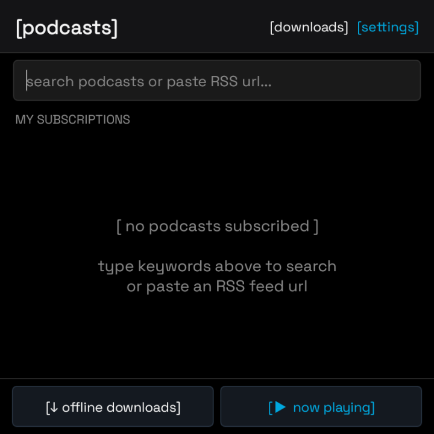
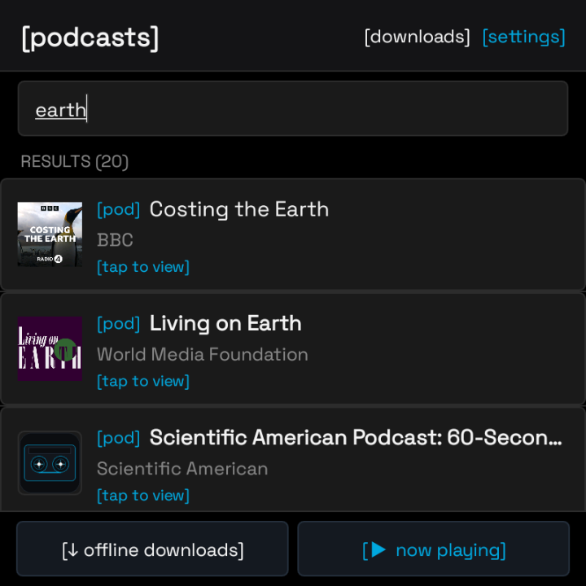
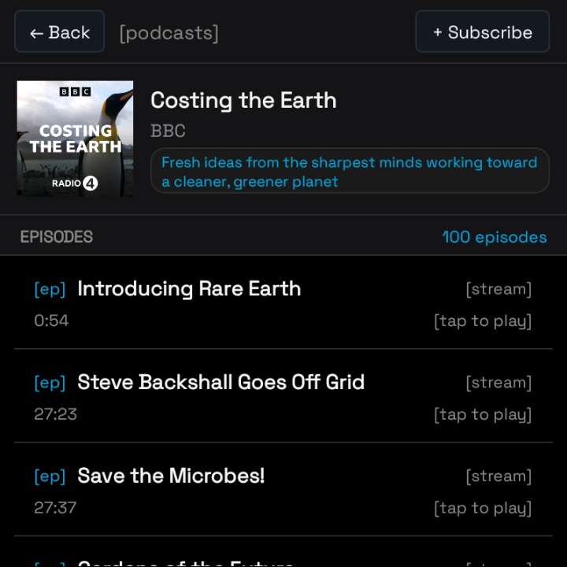
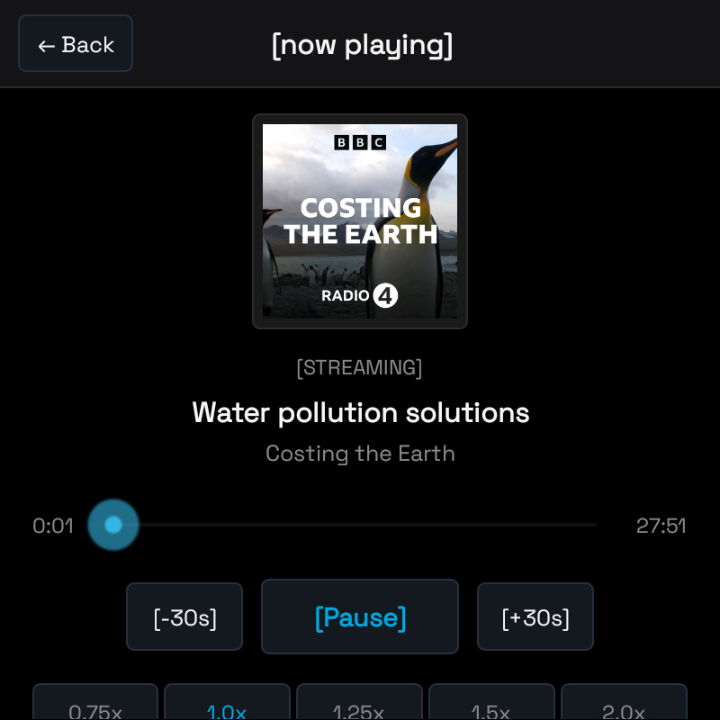
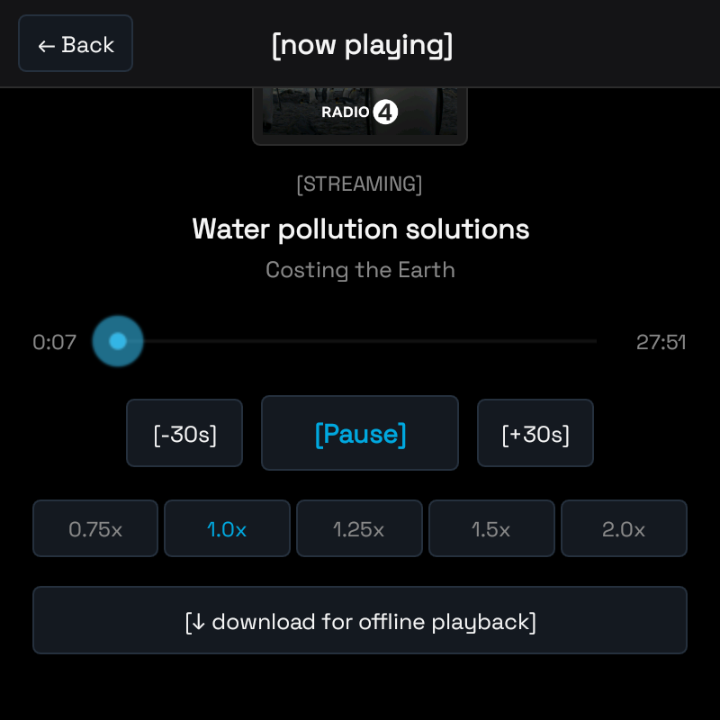

# PodBB 🎙️

**A modern, lightweight, standalone podcast client engineered from the ground up for BlackBerry 10 devices (Q5, Q10, Classic, and Passport).**

[-000000.svg?logo=blackberry)](https://github.com/warumpas-ops/podbb)
[-3DDC84.svg?logo=android)](https://github.com/warumpas-ops/podbb)
[-00A8DF.svg)](https://github.com/warumpas-ops/podbb)
[](https://github.com/warumpas-ops/podbb/releases/latest)
[](LICENSE)

---

## ⚡ The Backstory: Why PodBB?

If you still daily-drive or tinker with a BlackBerry 10 device in 2026, you know the struggle:

1. **BlackBerry World is dead** — no native apps can be downloaded or updated through official channels.
2. **Expired Root Certificates** — modern HTTPS podcast servers and CDNs reject BlackBerry 10's decade-old root certificate store.
3. **Android 4.3 Runtime Restrictions** — modern Android podcast clients (Pocket Casts, AntennaPod, Spotify) require Android 8.0+ and Google Play Services. Legacy APKs from 2014 fail to negotiate **TLS 1.2/1.3** or **SNI (Server Name Indication)**, causing immediate handshake failures and feed errors on Cloudflare, Akamai, and AWS CloudFront.
4. **Awkward 1:1 Aspect Ratio** — standard Android podcast apps are designed for 16:9 or 20:9 candy-bar phones. On the Q5, Q10, Classic (720×720), and Passport (1440×1440), headers consume half the screen and episode lists are cut off.

**PodBB solves all of this.** It is a native, zero-dependency Android 4.3 (API 18) application with custom TLS 1.2 + SNI reflection injection, tailored specifically for square BlackBerry screens with a NoteVault-inspired retro-futuristic dark mode aesthetic.

---

## 📸 Screenshots (Captured on BlackBerry Q5)

<div align="center">

| 1. Home / Subscriptions | 2. Apple Directory Search | 3. Episode List & Hero |
|:---:|:---:|:---:|
|  |  |  |
| *Clean dark OLED home with instant search* | *Apple Podcasts index (3M+ shows)* | *Collapsible hero + 100-episode feed* |

<br/>

| 4. Now Playing Screen | 5. Audio Controls & Offline Download |
|:---:|:---:|
|  |  |
| *High-res artwork + cyan custom scrubber* | *Variable speeds (0.75x–2.0x) + offline saving* |

</div>

---

## ✨ Features & Architecture

### 🌐 Access to 3 Million+ Shows (Apple Podcasts Index)
* **Global Search**: Queries the official Apple Podcasts directory as its primary index, giving BlackBerry 10 users instant access to virtually any show in the world (Huberman Lab, Lex Fridman, The Daily, BBC, Joe Rogan, etc.).
* **Live Canonical Feeds**: Pulls direct, up-to-date RSS feeds directly from creators and major hosts (Megaphone, Acast, Buzzsprout, Libsyn, Spotify/Anchor, Substack).
* **Direct RSS / Atom Fallback**: Paste any valid podcast feed URL (`https://...`) to load custom, private, or unlisted podcasts directly.
* **Secondary gpodder.net Index**: Automatic fallback for network independence.

### 🔐 Custom TLS 1.2 & SNI Injection Engine
* **Bypasses Expired BB10 Certificates**: Implements a permissive `SSLSocketFactory` that resolves modern TLS handshakes without relying on the outdated OS certificate bundle.
* **SNI (Server Name Indication) via Java Reflection**: Safely enables SNI on Android 4.3 without triggering the infamous reverse-DNS blocking bugs on BlackBerry 10 hardware.
* **Smart Downgrade & Sanitization**: Automatic GZIP decompression, XML entity sanitization (unescaped `&` recovery), and narrow HTTPS-to-HTTP fallback when a host allows plain HTTP.

### 🧈 Butter-Smooth Spotify-Style Scroll Animation
* **Square Screen Optimization**: On 720×720 screens, screen real estate is precious. PodBB features an alpha-linked hero banner that continuously fades between the full cover hero and a compact search-result card as you drag your finger.
* **Zero Leftover Gap**: When scrolling into the episode list, the expanded header automatically collapses to `View.GONE`, allowing all 100+ episodes to scroll seamlessly with zero black voids or layout stutter.

### 💾 Offline Episode Downloads & MicroSD Storage
* **One-Tap Offline Saving**: Tap `[↓ download for offline playback]` to download complete episodes locally.
* **Target Storage Selection**: Save episodes to internal memory or your removable **MicroSD Card** — crucial for devices like the BlackBerry Q5 with limited internal storage.
* **Smart Cache**: Memory + disk image caching prevents artwork from redownloading over cellular data.

### 🎵 Background Audio Playback Service
* Persistent background playback via a lightweight Android `Service`. Multitask freely on BB10 with active playback.
* Variable speed controls: **0.75x, 1.0x, 1.25x, 1.5x, 2.0x**.
* Jump back 30 seconds `[-30s]` and forward 30 seconds `[+30s]`.
* System notification controls and Mini-Player bar on the home screen.

### 🎨 NoteVault & Cyber-Minimalist Aesthetic
* **Pitch OLED Black (`#000000`) & Charcoal (`#141416`)**: Saves battery life on AMOLED screens (Q10/Passport) and looks gorgeous on IPS LCD (Q5/Classic).
* **Electric Cyan (`#00A8DF`) Accents**: High-contrast indicators and status badges (`[stream]`, `[done]`, `[offline]`).
* **Space Grotesk Monospaced Typography**: Clean, legible, tech-forward terminal vibe.
* **Handcrafted Pixel Art Cassette Icon**: Custom launcher icon featuring a clean cyber wireframe cassette tape designed for the BlackBerry 10 app grid.

---

## 📱 Device Compatibility

| Device | Screen Resolution | Display Type | Keyboard | Status |
|:---|:---:|:---:|:---:|:---:|
| **BlackBerry Q5** | 720 × 720 (1:1) | IPS LCD | Physical QWERTY | **Primary Target** ✅ |
| **BlackBerry Q10** | 720 × 720 (1:1) | Super AMOLED | Physical QWERTY | **Fully Supported** ✅ |
| **BlackBerry Classic (Q20)** | 720 × 720 (1:1) | IPS LCD | Trackpad + QWERTY | **Fully Supported** ✅ |
| **BlackBerry Passport** | 1440 × 1440 (1:1) | IPS LCD | Touch-enabled QWERTY | **Fully Supported** ✅ |
| **BlackBerry Z10 / Z30 / Leap** | 720 × 1280 (16:9) | OLED / LCD | All-Touch | **Supported** ✅ |

---

## 🚀 How to Install on BlackBerry 10

### Method 1: Direct Download via BB10 Browser (Recommended)
1. Open the native **BlackBerry Browser** on your phone.
2. Go to: [github.com/warumpas-ops/podbb/releases/latest](https://github.com/warumpas-ops/podbb/releases/latest)
3. Download `PodBB-vX.Y.Z.apk`.
4. Once downloaded, tap the notification or open the **File Manager** app -> **Downloads**.
5. Tap the `.apk` file and select **Install** in the top right corner.

### Method 2: Sideload via USB / MicroSD
1. Download `PodBB.apk` from the [Releases](https://github.com/warumpas-ops/podbb/releases) page on your computer.
2. Copy the file to your BlackBerry's internal memory or MicroSD card via USB cable.
3. On the phone, open **File Manager**, locate the APK, and tap **Install**.

> **Note for First-Time Sideloaders:**  
> Ensure third-party installations are allowed:  
> Go to **Settings** → **Security and Privacy** → **Application Permissions** → Enable **Allow Installation of Apps from Other Sources**.

---

## 🛠️ Building from Source

PodBB uses Gradle with a pure Android SDK toolchain. It does not use heavy external frameworks, keeping the binary tiny (< 3 MB) and blazing fast.

### Prerequisites
* JDK 17
* Android SDK (Platforms 18 & 34, Build Tools 34.0.0)

### Build Commands

```bash
# Clone the repository
git clone https://github.com/warumpas-ops/podbb.git
cd podbb

# Build the Debug APK
./gradlew assembleDebug

# Output APK location:
# app/build/outputs/apk/debug/app-debug.apk
```

---

## 📋 Technical Details

* **Package ID**: `com.podbb.app`
* **Min SDK**: `14` (Android 4.0 ICS)
* **Target SDK**: `18` (Android 4.3 Jelly Bean — Native BlackBerry 10 subsystem)
* **Compile SDK**: `34`
* **Network Stack**: Native `HttpURLConnection` with TLS 1.2 override & reflection SNI
* **Database**: Embedded SQLite (`DatabaseHelper.java`)
* **Audio Engine**: Android `MediaPlayer` wrapped in background `PlayerService`
* **Dependencies**: **Zero** external runtime dependencies (no Retrofit, no OkHttp, no Glide, no Google Play Services). Pure native Android APIs.

---

## 📄 License

This project is licensed under the [MIT License](LICENSE) — free and open source forever for the retro-tech and BlackBerry community.
